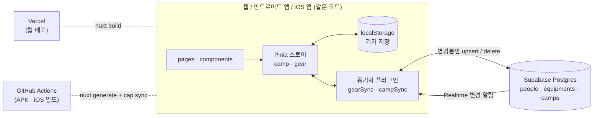
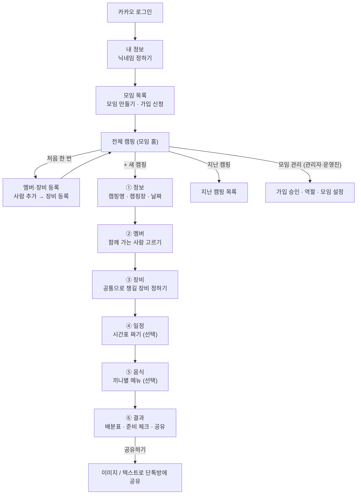
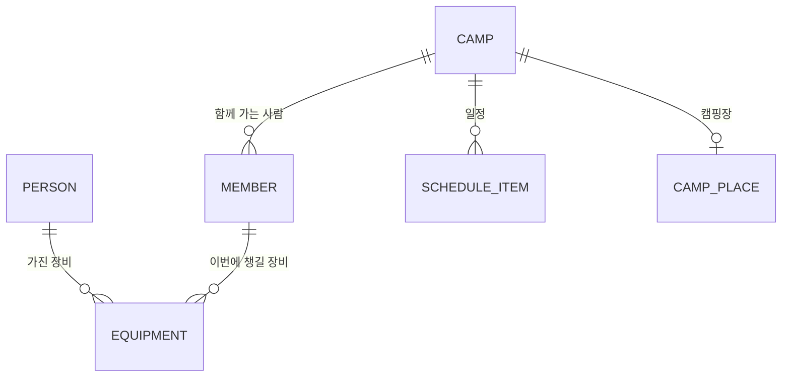

# Camping&Joy

함께 캠핑 가는 사람들이 **누가 어떤 장비를 챙길지** 한 곳에서 정하고 확인하는 서비스예요.
웹(https://camping-joy.vercel.app)과 안드로이드·iOS 앱으로 쓸 수 있어요. 카카오로 로그인하고, 모임 단위로 멤버·장비·캠핑을 나눠 써요.

## 목차

1. [개발 목적](#개발-목적)
2. [주요 기능](#주요-기능)
3. [기술 스택](#기술-스택)
4. [전체 구조](#전체-구조)
5. [사용 흐름](#사용-흐름)
6. [데이터 모델](#데이터-모델)
7. [서버 동기화 방식](#서버-동기화-방식)
8. [폴더 구조](#폴더-구조)
9. [개발 규칙](#개발-규칙)
10. [시작하기](#시작하기)
11. [배포](#배포)
12. [알아 둘 점](#알아-둘-점)

---

## 개발 목적

여럿이 캠핑을 가면 단톡방에서 이런 대화가 반복돼요.

- "텐트 누가 가져와?", "버너 두 개 오는 거 아니야?", "아이스박스는 누구 거 쓰지?"
- 누가 뭘 챙기기로 했는지 메시지가 묻혀서 다시 물어보고, 당일에 빠뜨리거나 겹쳐요.

Camping&Joy는 이 과정을 정리하려고 만들었어요.

- **장비는 한 번만 등록:** 사람마다 가진 장비를 한 번 등록해 두면 캠핑할 때마다 불러와요.
- **겹치지 않게 나누기:** 이번 캠핑에 공통으로 챙길 장비를 고르면 주인이 챙기는 것으로 정해지고, 같은 장비가 남는지 바로 보여요.
- **모두가 같은 화면:** 카카오로 로그인해 같은 모임에 들어오면 모두가 같은 캠핑·장비 목록을 보고 고쳐요. 모임 관리자가 가입 신청을 승인해요.
- **결과 공유:** 정리된 배분표와 일정을 이미지나 텍스트로 단톡방에 바로 보낼 수 있어요.

처음 쓰는 사람도 설명 없이 쓸 수 있도록, 화면은 단계별로 나누고 버튼과 문구는 최대한 단순하게 유지해요.

## 주요 기능

| 기능 | 설명 |
| --- | --- |
| 카카오 로그인·내 정보 | 카카오로 로그인하고 닉네임·인사말·프로필 이미지를 정해요 |
| 모임 | 모임을 만들거나(이름·설명·지역) 목록에서 골라 가입 신청. 모임마다 멤버·장비·캠핑이 따로 있어요 |
| 모임 관리 | 가입 신청 승인·거절, 운영진 지정·해제, 관리자 위임, 내보내기, 모임 정보 수정·삭제. 가입 신청이 있으면 메뉴와 "가입 신청 N건"에 빨간 점 |
| 역할 | 관리자(owner) · 운영진(admin) · 멤버(member). 일반 멤버는 본인 카드만 만들고 고치며, 다른 멤버 등록·삭제는 관리자·운영진이 해요 |
| 멤버·장비 등록 | 사람을 추가하고 각자 가진 장비(카테고리·수량·크기·텐트 이름)를 등록. 이름 검색 지원. 한 카드를 여러 카카오 계정이 함께 쓸 수도 있어요 |
| 캠핑 만들기 | 캠핑명, 캠핑장(이름·주소), 날짜 입력. "네이버 지도에서 보기"로 위치 확인 |
| 멤버 고르기 | 등록된 사람 중 이번에 함께 가는 사람 선택 |
| 장비 배분 | 멤버들이 가진 장비를 "공통으로 챙길 장비"로 끌어다 놓거나 + 로 추가. 남은 수량 표시 |
| 일정 | 1일차·2일차로 나눠 30분 단위 시간표 작성 (집합·입실·점심 같은 빠른 입력) |
| 음식 | 끼니별 메뉴 정리 |
| 결과 | 캠핑 정보, 일정, 장비별·멤버별 배분표, 준비 완료 체크, 아무도 안 챙기는 장비 |
| 공유 | 결과를 이미지(공유 카드)나 메신저용 텍스트로 공유. 모바일은 바텀시트, PC는 모달 |
| 캠핑 목록 | 다가올 캠핑은 가까운 날짜순, 지난 캠핑은 따로 모아 최근 날짜순. 캠핑장 이름을 적기 전의 빈 캠핑은 목록에 보이지 않아요 |
| 실시간 반영 | 다른 사람이 고친 내용이 새로고침 없이 반영 |
| 모바일 화면 | 하단 탭바(전체 캠핑 · 장비 등록 · 더보기), 한 단계 안으로 들어갈 때 옆에서 밀려 들어오는 화면 전환, 화면 왼쪽 가장자리 스와이프로 뒤로가기, 장비 배분은 이름을 눌러 바텀시트로 추가 |
| 움직임 | 드롭다운·모달·바텀시트가 열고 닫을 때 애니메이션. `prefers-reduced-motion`이면 줄여요 |

## 기술 스택

| 영역 | 사용 기술 | 쓰는 이유 |
| --- | --- | --- |
| 프레임워크 | **Nuxt 4** (SPA, `ssr: false`) · **Vue 3** | 파일 기반 라우팅, 자동 import. 앱에 넣을 정적 파일을 `nuxt generate`로 바로 만듦 |
| 언어 | **TypeScript** (strict, `any` 사용 안 함) | 캠핑·장비 데이터 구조를 타입으로 먼저 정하고 개발 |
| 상태 관리 | **Pinia** + `pinia-plugin-persistedstate` | 캠핑·장비 상태를 스토어 두 개로 관리하고 기기(localStorage)에 저장 |
| 스타일 | **SCSS** + CSS 변수 디자인 토큰 | 색·간격·반경을 `_tokens.scss` 한 곳에서 관리 |
| 백엔드 | **Supabase** (PostgreSQL · Auth · Realtime · Storage) | 서버 코드 없이 카카오 로그인, DB(RLS·RPC), 실시간 알림, 프로필 이미지 저장 사용. 공개용(publishable) 키만 앱에 넣음 |
| 앱 | **Capacitor 8** (Android · iOS) | 웹 빌드를 그대로 앱 안에 넣음. 인터넷이 약한 캠핑장에서도 열림 |
| 웹 배포 | **Vercel** | `main`에 머지되면 자동 배포 |
| 앱 빌드 | **GitHub Actions** | PR·머지마다 안드로이드 APK와 iOS 빌드를 자동으로 만듦 |
| 화면 전환 | 브라우저 **View Transition** (Nuxt `experimental.viewTransition`) | 라이브러리 없이 슬라이드 전환. 지원하지 않는 환경에서는 효과 없이 바로 바뀜 |
| 기타 | `vue-draggable-plus`(끌어다 놓기), `html-to-image`(공유 이미지), 네이버 지도 JS API v3(선택) | 배분 화면 드래그, 결과 이미지 공유, 캠핑장 위치 |

패키지 매니저는 **pnpm**이에요.

## 전체 구조



- **화면은 스토어만 봐요.** 페이지와 컴포넌트는 Pinia 스토어를 읽고 액션을 호출할 뿐, 서버를 직접 부르지 않아요.
- **스토어는 기기에 먼저 저장돼요.** 인터넷이 끊겨도 마지막 상태로 열리고, 고친 내용은 연결되면 올라가요.
- **서버와 맞추는 일은 플러그인 두 개가 맡아요.** `gearSync`(멤버·장비)와 `campSync`(캠핑)가 스토어 변경을 지켜보다가 서버에 올리고, 다른 사람의 변경은 Realtime 알림으로 받아요.
- **Supabase 환경 변수가 없으면** 동기화 플러그인이 꺼지고 기기에만 저장되는 모드로 동작해요.

## 사용 흐름



0. **로그인과 모임** (`/login`, `/profile`, `/`)
   카카오로 로그인하고 닉네임을 정하면 모임 목록이 나와요. 모임을 만들면 내가 관리자가 되고, 다른 모임은 가입을 신청한 뒤 관리자·운영진이 승인하면 들어갈 수 있어요. 모임 안의 모든 주소는 `/g/:groupId/...`예요.
1. **멤버·장비 등록** (`/g/:groupId/gear`)
   함께 캠핑 가는 사람을 추가하고, 사람마다 가진 장비를 등록해요. 텐트·테이블·아이스박스는 크기를 고르고, 텐트는 이름(예: 코베아 고스트)도 적을 수 있어요. 한 번 등록하면 모든 캠핑에서 불러와요.
2. **캠핑 정보** (`/g/:groupId/camps/:id/info`)
   캠핑명, 캠핑장 이름과 주소, 날짜를 적어요. 캠핑명과 날짜만 필수예요.
3. **멤버** (`.../members`)
   등록된 사람 중 이번에 가는 사람을 골라요. 인원이 많아도 후보는 일정 높이 안에서 스크롤되고, 모바일에서는 선택한 멤버가 이름표(칩)로 모여요.
4. **장비** (`.../distribute`)
   PC는 오른쪽 "멤버들이 가진 장비"에서 이번에 쓸 장비를 "공통으로 챙길 장비"로 끌어다 놓거나 + 를 눌러요. 모바일은 멤버 이름을 눌러 바텀시트에서 추가해요. 장비는 주인이 챙기는 것으로 정해지고, 남은 수량이 함께 보여요.
5. **일정** (`.../schedule`)
   1일차·2일차로 나눠 30분 단위로 일정을 적어요. 비워 둬도 넘어갈 수 있어요.
6. **음식** (`.../meals`)
   끼니별 메뉴를 적어요.
7. **결과** (`.../result`)
   캠핑 정보, 일정, 누가 무엇을 챙기는지(장비별·멤버별)를 보고 준비한 장비는 "완료"로 체크해요. "공유하기"로 이미지나 텍스트를 보내요.

**화면 깊이와 이동:** `utils/navDepth.ts`가 화면 깊이를 정해요(0: 모임 목록·로그인, 1: 모임 홈·장비 등록, 2: 그 안쪽 화면). 모바일에서 깊이 1은 하단 탭바를, 깊이 2는 뒤로가기 + 제목 헤더를 보여 주고, 깊이가 바뀔 때 `plugins/navSlide.client.ts`가 슬라이드 방향을 정해요. 모바일에서는 화면 왼쪽 가장자리를 밀면 뒤로 가요.

단계 이동 규칙은 `utils/campSteps.ts`와 `middleware/03.camp.global.ts`가 정해요. 앞 단계를 채우지 않으면 다음 단계로 갈 수 없고, 주소로 바로 들어오면 갈 수 있는 마지막 단계로 보내요. "+ 새 캠핑"만 누르고 정보를 저장하지 않은 빈 캠핑은 홈에 돌아오면 지워져요.

## 데이터 모델

앱 타입은 `app/types/camp.ts`, DB 행 타입은 `app/types/database.ts`에 있어요.



| 타입 | 설명 |
| --- | --- |
| `Person` | 멤버·장비 등록의 사람. `id`, `name`, `equipments` |
| `Equipment` | 장비. `name`, `category`(텐트/타프·테이블/의자·주방·침구·조명·기타), `quantity`, `size?`, `model?`, `ownerId` |
| `Camp` | 캠핑. `name`(캠핑명), `place?`(캠핑장 이름·주소), `date`, `members`, `requiredEquipments`, `assignments`, `readyItems`, `schedule` |
| `Member` | 캠핑에 가는 사람. `id`는 `Person.id`와 같고, `equipments`는 이번에 가져갈 장비와 수량 |
| `RequiredEquipment` · `Assignment` | 이번 캠핑에 필요한 장비와, 그것을 어느 멤버의 어떤 장비로 준비할지 |
| `ScheduleItem` | 일정 한 줄. `day`(몇째 날), `time`('HH:MM'), `title` |

**Supabase 테이블** (`supabase/migrations/`)

| 테이블 | 내용 |
| --- | --- |
| `profiles` | 로그인 계정의 프로필 (`id` → auth.users, `nickname`, `greeting`, `avatar`). 이미지는 `avatars` 버킷에 본인 폴더로 저장 |
| `groups` | 모임 (`name` 유일(대소문자 무시), `description`, `region`) |
| `group_members` | 모임 구성원과 역할 (`owner` · `admin` · `member` · `pending`). 모임마다 `owner`는 한 명 |
| `people` | 사람 (`id`, `name`, `group_id`, `user_id`). `user_id`는 이 카드의 대표 카카오 계정 |
| `person_accounts` | 한 멤버 카드를 함께 쓰는 나머지 계정. 앱은 읽기만 하고, 연결은 관리자가 DB에서 해요 |
| `equipments` | 사람별 장비 (`person_id`, `name`, `category`, `size`, `model`, `quantity`) |
| `camps` | 캠핑 (`id`, `name`, `date`, `group_id`) + 멤버·배분·준비 체크·일정·음식·캠핑장을 `data`(jsonb)에 그대로 저장 |

모든 테이블에 RLS가 켜져 있고, 모임 구성원인지·역할이 무엇인지로 읽기·쓰기를 정해요(anon은 막혀 있어요). 모임을 만들고 가입·승인·역할 변경·내보내기·관리자 위임·삭제는 `security definer` RPC(`create_group`, `request_join`, `cancel_join`, `decide_join`, `set_member_role`, `remove_group_member`, `transfer_ownership`, `update_group`, `delete_group`)로만 해요. `people`·`equipments`·`camps`는 Realtime 알림 대상이에요.

| 역할 | 할 수 있는 일 |
| --- | --- |
| 관리자 (`owner`) | 전부. 운영진 지정·해제, 관리자 위임(운영진에게만), 모임 정보 수정·삭제 |
| 운영진 (`admin`) | 가입 승인·거절, 일반 멤버 내보내기, 모든 멤버 카드·캠핑 수정 |
| 멤버 (`member`) | 본인 멤버 카드(한 장)와 내 장비 수정, 캠핑 보기·수정 |
| 가입 신청 중 (`pending`) | 모임 안을 볼 수 없고 신청 취소만 가능 |

## 서버 동기화 방식

`plugins/gearSync.client.ts`와 `plugins/campSync.client.ts`가 같은 방식으로 동작해요.

0. **모임에 들어올 때:** `middleware/02.group.global.ts`가 현재 모임을 정하고, 그 모임의 멤버·장비·캠핑만 불러와 구독해요. 모임을 바꾸면 이전 구독은 끊어요.
1. **앱을 열 때:** 서버 목록을 받아 스토어를 바꾸고, 그 내용을 **baseline**(마지막으로 서버와 맞춘 상태)으로 기억해요. 처음 연결하는 기기라면 그동안 기기에만 있던 데이터를 한 번 올려요.
2. **이 기기에서 고칠 때:** 스토어 변경을 지켜보다가(0.6초 디바운스) baseline과 비교해서 **바뀐 행만 upsert, 사라진 행만 delete** 해요. 전체를 덮어쓰지 않기 때문에 다른 사람이 동시에 고친 내용을 지우지 않아요.
3. **다른 기기에서 고칠 때:** Realtime 알림이 오거나 앱으로 돌아오면(화면이 다시 보일 때) 서버 목록을 다시 받아요. 이 기기에서 올리는 중이면 끝난 뒤에 받아요.
4. **인터넷이 안 될 때:** 기기 저장본으로 계속 쓰고, 다음에 고칠 때 다시 올려요.

"나는 ○○" 선택(`meId`)은 기기마다 다르기 때문에 서버에 올리지 않아요.

## 폴더 구조

```
app/
  pages/
    index.vue                 모임 목록 (모임 만들기, 가입 신청)
    login.vue                 카카오 로그인
    profile.vue               내 정보 (닉네임·인사말·프로필 이미지)
    g/[groupId]/
      index.vue               모임 홈 = 전체 캠핑 (다가올 캠핑, 지난 캠핑 링크)
      gear.vue                멤버·장비 등록 (검색, 멤버 추가)
      manage.vue              모임 관리 (가입 승인, 역할, 관리자 위임, 모임 설정·삭제)
      camps/past.vue          지난 캠핑
      camps/[campId]/
        info.vue              ① 캠핑 정보 (캠핑명·캠핑장·날짜)
        members.vue           ② 멤버
        distribute.vue        ③ 장비 배분 (끌어다 놓기, 모바일은 바텀시트)
        schedule.vue          ④ 일정
        meals.vue             ⑤ 음식
        result.vue            ⑥ 결과·준비 체크·공유
  components/
    BottomTabs.vue            모바일 하단 탭바와 더보기 시트
    ConfirmModal.vue          확인 창 (useConfirm으로 호출)
    RoleBadge.vue             관리자·운영진 배지
    CampListItem.vue          캠핑 카드 (홈·지난 캠핑에서 같이 씀)
    PersonGearCard.vue        사람별 장비 카드 (장비 추가·크기·수량)
    SelectMenu.vue            앱 전체에서 쓰는 선택 목록 (기본 select 대신)
    StepNav.vue               캠핑 단계 표시
    ShareSheet.vue            공유 이미지·텍스트
    PlaceMap.vue              캠핑장 지도 / 네이버 지도 열기
  stores/
    auth.ts                   로그인·프로필
    group.ts                  모임·구성원·역할, 가입·위임 액션
    camp.ts                   캠핑·멤버·배분·준비 체크·일정
    gear.ts                   사람·보유 장비
  plugins/
    gearSync.client.ts        멤버·장비 ↔ Supabase
    campSync.client.ts        캠핑 ↔ Supabase
    navSlide.client.ts        화면 전환 방향 결정, 가장자리 스와이프 뒤로가기
    capacitor.client.ts       안드로이드 뒤로가기 버튼
  composables/
    useSupabase.ts            Supabase 클라이언트 (환경 변수 없으면 null)
    useIsMobile.ts            모바일 화면(1080px 이하) 여부
    useConfirm.ts             확인 창 호출
    useNaverMaps.ts           네이버 지도 스크립트 로드·주소 → 좌표
  middleware/
    01.auth.global.ts         로그인·프로필 확인
    02.group.global.ts        현재 모임 정하고 데이터 불러오기, 소속 확인
    03.camp.global.ts         캠핑 선택, 단계 접근 제한
  types/                      도메인 타입(camp.ts), DB 타입(database.ts)
  utils/                      날짜·일정 포맷, 단계 계산, 공유 문구, 장비 이름 표시 등 순수 함수
  constants/                  장비 카테고리·프리셋·크기, 캠핑 단계
  assets/scss/                디자인 토큰, 반응형 기준(1080px), 공통 스타일
  layouts/default.vue         헤더(깊이별 뒤로가기·제목)·메뉴·하단 탭바·safe area
supabase/migrations/          DB 테이블·RLS·Realtime 설정 SQL
android/ · ios/               Capacitor 네이티브 프로젝트
assets/                       앱 아이콘·스플래시 원본
.github/workflows/            안드로이드 APK·iOS 빌드
```

## 개발 규칙

- **타입 먼저:** 데이터 구조를 `types/`에 먼저 정하고 개발해요. `any`는 쓰지 않아요.
- **`.vue` 파일 순서:** `<template>` → `<script setup lang="ts">` → `<style scoped lang="scss">`
- **함수 내보내기:** `utils/`·`composables/`(useSupabase 제외)는 `export default { 함수() {} }` 객체로 내보내고, 쓰는 곳에서 명시 import 해요. 로컬 함수는 반환 타입을 적은 화살표 함수(`const f = (): void => {}`)로 써요.
- **선택 목록:** 기본 `<select>` 대신 `components/SelectMenu.vue`를 써요.
- **컴포넌트는 필요할 때만 나눠요.** 여러 화면에서 같이 쓰는 것만 컴포넌트로 빼요.
- **색·간격은 토큰으로:** `var(--color-primary)`, `var(--space-3)`처럼 `_tokens.scss`의 변수를 써요.
- **반응형:** `@include mobile` / `@include pc` (기준 1080px)
- 푸시 전에 `pnpm typecheck`와 `pnpm generate`가 통과하는지 확인해요.

## 시작하기

```bash
pnpm install
pnpm dev            # http://localhost:3000
pnpm typecheck      # 타입 검사
pnpm generate       # 정적 SPA 빌드 (.output/public)
```

### 환경 변수

`.env`에 넣거나 Vercel 환경 변수로 설정해요. 모두 앱에 들어가도 되는 공개용 값이에요.

| 이름 | 설명 |
| --- | --- |
| `NUXT_PUBLIC_SUPABASE_URL` | Supabase 프로젝트 주소. 비우면 기기에만 저장 |
| `NUXT_PUBLIC_SUPABASE_KEY` | Supabase **publishable(anon) 키**. service_role(secret) 키는 절대 넣지 않아요 |
| `NUXT_PUBLIC_NAVER_MAP_KEY_ID` | (선택) 네이버 클라우드 Maps Client ID. 비우면 화면 안 지도 없이 "네이버 지도에서 보기" 버튼만 보여요 |

### Supabase 준비

Supabase 대시보드의 SQL Editor에서 `supabase/migrations/`의 파일을 이름 순서대로 실행해요. 카카오 로그인은 Supabase Authentication의 Kakao provider를 켜고 카카오 개발자 콘솔의 Redirect URI를 맞춰야 해요.

개발은 운영 DB 대신 로컬 Supabase(Docker)를 쓰는 것을 권장해요. 방법은 `supabase/AGENTS.md`의 "로컬 개발 DB"를 보세요. 운영 DB에 마이그레이션을 직접 적용할 때는 반드시 확인한 뒤에 해요.

## 배포

### 웹 (Vercel)

Vercel에서 이 저장소를 Import 하면 Nuxt로 자동 인식돼요(빌드 `pnpm build`). `main`에 머지될 때마다 자동으로 다시 배포돼요.

### 안드로이드 앱

웹 빌드(`.output/public`)를 앱 안에 넣는 방식이라 인터넷이 약한 곳에서도 열려요.

- **APK 받기:** GitHub Actions의 "Android APK" 실행 결과에서 `camping-joy-debug-apk`를 받아 폰에 설치
- **직접 빌드:** `pnpm android:sync` 후 `pnpm android:open`으로 Android Studio에서 실행
- **화면 가장자리:** Capacitor `SystemBars`(`insetsHandling: 'css'`)가 상·하단 바 높이를 `--safe-area-inset-*` CSS 변수로 넣어 주고, 레이아웃이 이 값만큼 여백과 하단 배경을 깔아요.
- 앱 아이콘·스플래시 원본은 `assets/`, 바꾼 뒤 `npx @capacitor/assets generate --android`

### iOS 앱

- **빌드 확인:** GitHub Actions의 "iOS build"가 서명 없이 시뮬레이터용으로 빌드해요.
- **아이폰에 설치:** Mac에서 `pnpm ios:sync` 후 `pnpm ios:open` → Xcode의 Signing & Capabilities에서 Team(Apple ID)을 고르고 아이폰을 연결해 실행
- 아이콘·스플래시를 바꾼 뒤 `npx @capacitor/assets generate --ios`

## 알아 둘 점

- **카카오 로그인이 필요해요.** 모임에 들어온 사람만 그 모임의 캠핑·장비를 볼 수 있어요. 모임 안에서는 멤버 누구나 캠핑을 고칠 수 있어요(가까운 모임끼리 쓰는 것을 전제). Supabase 환경 변수가 없으면 로그인 없이 기기에만 저장하는 모드로 열려요.
- **모임 관리자는 한 명이에요.** 나가야 할 때는 먼저 운영진 중 한 명에게 관리자를 위임해야 해요.
- **화면 전환 효과**는 View Transition을 지원하는 브라우저에서만 보여요. 가장자리 스와이프 뒤로가기는 손가락을 따라 움직이는 방식이 아니라 밀면 바로 뒤로 가는 방식이에요.
- **동시에 같은 캠핑을 고치면** 나중에 저장한 쪽 내용으로 맞춰져요(캠핑 하나가 한 행).
- **화면 안 네이버 지도**는 네이버 클라우드 Maps 키가 있어야 나와요. 키가 없어도 "네이버 지도에서 보기"로 지도 앱·웹은 열려요.
